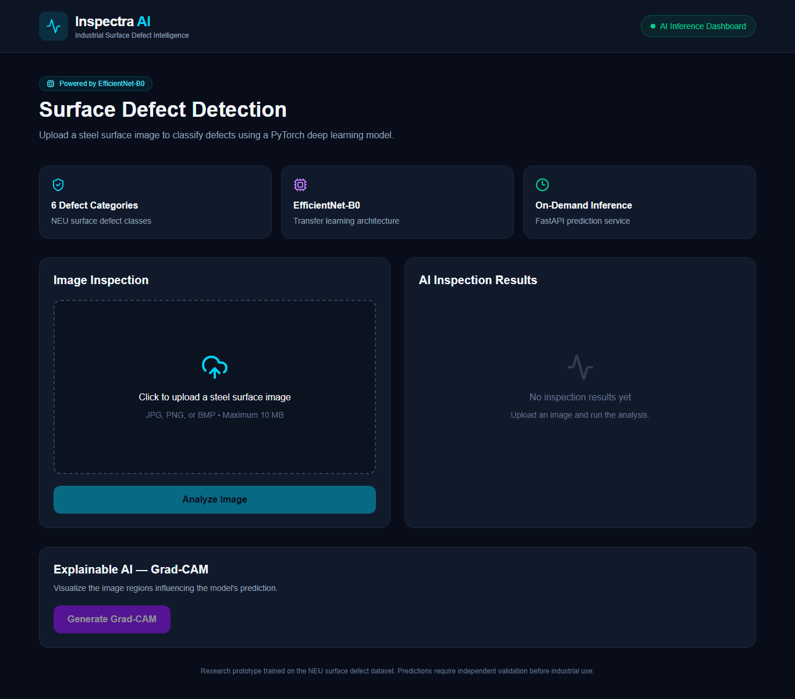
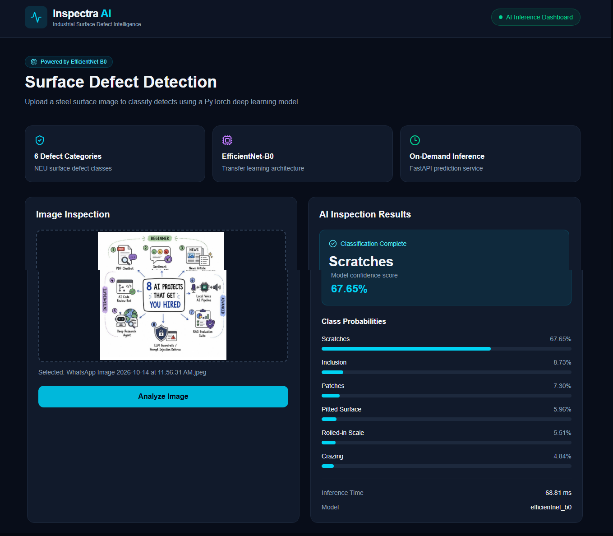
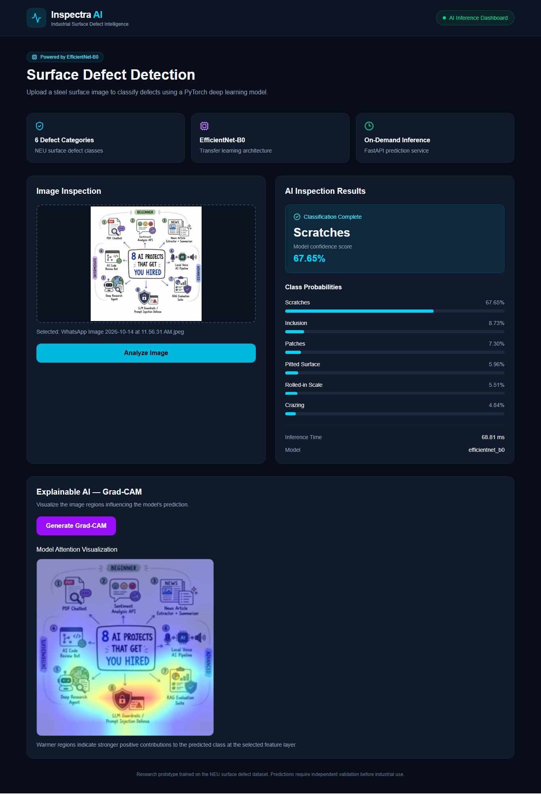

# Inspectra AI

### Industrial Surface Defect Detection with Deep Learning and Explainable AI

[](https://github.com/tahirsaeedtech-stack/inspectra-ai-industrial-defect-detection/actions/workflows/ci.yml)

**[Live Dashboard](https://inspectra-ai-industrial-defect-dete.vercel.app)** · **[API Health](https://inspectra-ai-api-720530335077.asia-south1.run.app/health)** · **[API Docs](https://inspectra-ai-api-720530335077.asia-south1.run.app/docs)**

Inspectra AI is an end-to-end computer vision application that classifies industrial surface defects from uploaded images. It combines an **EfficientNet-B0** image classifier, a **FastAPI** inference service, a **React** dashboard, and **Grad-CAM** visual explanations. The backend runs in a Docker container on **Google Cloud Run**, and the frontend is deployed on **Vercel**.

> **Scope:** This is a portfolio and research demonstration trained on the NEU surface-defect dataset. Its reported validation results do **not** establish reliability on unseen factories, cameras, materials, or operating conditions. It is not a certified industrial quality-control system.

## Live Demo

1. Open the [Inspectra AI dashboard](https://inspectra-ai-industrial-defect-dete.vercel.app).
2. Upload a supported surface image (JPEG, PNG, or BMP; maximum **10 MB**).
3. Review the predicted defect class, confidence score, class probabilities, and inference time.
4. Generate a **Grad-CAM** heatmap to inspect the regions influencing the prediction.

## Screenshots

Add screenshots to `docs/screenshots/` and uncomment the following lines once the files are committed:

<!--



-->

## Defect Classes

The classifier predicts one of six NEU surface-defect categories:

| Class | Label returned by the API |
| --- | --- |
| Crazing | `crazing` |
| Inclusion | `inclusion` |
| Patches | `patches` |
| Pitted surface | `pitted_surface` |
| Rolled-in scale | `rolled-in_scale` |
| Scratches | `scratches` |

## Architecture

```text
User's browser
    │
    ▼
React + Vite dashboard (Vercel)
    │  POST /predict or POST /explain
    ▼
FastAPI inference service (Google Cloud Run)
    ├── Image validation and preprocessing
    ├── EfficientNet-B0 (PyTorch)
    ├── Class probabilities and inference metadata
    └── Grad-CAM visualization

Docker image → Google Artifact Registry → Cloud Run
GitHub push / pull request → GitHub Actions (frontend + backend checks)
```

## Technology Stack

| Layer | Technologies |
| --- | --- |
| Model | PyTorch, torchvision, EfficientNet-B0 |
| Explainability | Grad-CAM, Matplotlib |
| Backend | Python, FastAPI, Uvicorn, Pillow |
| Frontend | React, Vite, JavaScript |
| Container | Docker |
| Backend hosting | Google Cloud Run, Artifact Registry, Cloud Build |
| Frontend hosting | Vercel |
| Quality checks | pytest, GitHub Actions, ESLint, Vite build |

## Dataset and Model Evaluation

**Dataset:** NEU Surface Defect Database (NEU-DET), using six labeled surface-defect categories.

| Split | Images |
| --- | ---: |
| Training | 1,440 |
| Validation | 360 |
| **Total** | **1,800** |

Models explored during development:

| Model | Observed validation accuracy |
| --- | ---: |
| Custom CNN baseline | ~79.44% |
| ResNet18 (transfer learning) | 100% |
| EfficientNet-B0 (transfer learning) | 100% |

**Selected deployment model:** EfficientNet-B0.

**Evaluation caveat:** These figures come from the project's development validation split, which was also used during model selection. The 100% result is **not** an independent test-set score and should not be interpreted as expected real-world accuracy. Further work should include a separate held-out test set, cross-domain evaluation, class-level precision/recall/F1, calibration analysis, and testing under production imaging conditions.

## API

**Base URL:** `https://inspectra-ai-api-720530335077.asia-south1.run.app`

| Method | Endpoint | Purpose |
| --- | --- | --- |
| `GET` | `/` | Application status |
| `GET` | `/health` | Health response |
| `POST` | `/predict` | Predict the defect class and probabilities |
| `POST` | `/explain` | Return Grad-CAM explanation data |
| `GET` | `/docs` | Interactive FastAPI documentation |

Both prediction endpoints accept an uploaded image as multipart form data using the field name **`file`**. The backend enforces a **10 MB** upload limit and validates that the file can be decoded as an image.

Example request:

```bash
curl -X POST \
  "https://inspectra-ai-api-720530335077.asia-south1.run.app/predict" \
  -F "file=@sample_defect.jpg"
```

The `/predict` response includes `prediction`, `confidence`, `processing_time_ms`, `model`, and `probabilities`. See `/docs` for the running API's interactive interface.

## Run Locally

### Prerequisites

- Python and a compatible PyTorch installation
- Node.js and npm
- The trained EfficientNet-B0 checkpoint at `backend/models/inspectra_efficientnet_best.pth`

### Backend

From the repository root:

```powershell
cd backend
python -m venv .venv
.\.venv\Scripts\python.exe -m pip install -r requirements.txt
.\.venv\Scripts\python.exe -m uvicorn app.main:app --host 127.0.0.1 --port 8000
```

**Note:** Install compatible `torch` and `torchvision` packages if they are not included in `backend/requirements.txt`. The model checkpoint is required at startup; the application cannot serve predictions without it.

### Frontend

In another terminal, from the repository root:

```powershell
cd frontend
npm install
npm run dev
```

For a custom backend address, create `frontend/.env.local`:

```dotenv
VITE_API_URL=http://127.0.0.1:8000
```

Open the local URL printed by Vite (typically `http://localhost:5173`).

### Docker Backend

From the repository root:

```bash
docker build -t inspectra-ai-backend ./backend
docker run --rm -p 8000:8000 inspectra-ai-backend
```

## Tests and CI

The GitHub Actions workflow (`.github/workflows/ci.yml`) runs on pushes and pull requests to `main` and can be started manually. It checks:

- **Frontend:** dependency installation, ESLint, and production build.
- **Backend:** Python environment setup and FastAPI tests using pytest.

Run backend tests locally from `backend/`:

```powershell
.\.venv\Scripts\python.exe -m pytest tests/ -v
```

Run frontend checks from `frontend/`:

```bash
npm run lint
npm run build
```

The CI workflow verifies code checks; it does **not** by itself deploy the application to production.

## Production Deployment

- **Backend:** A Docker image is built using Google Cloud Build, stored in Artifact Registry, and deployed to Cloud Run.
- **Cloud Run container port:** `8000` (must match the Uvicorn listener).
- **Frontend:** Vercel builds the `frontend/` Vite project with `VITE_API_URL` pointing to the Cloud Run service.
- **CORS:** The FastAPI application permits the deployed Vercel origin. The optional `FRONTEND_URL` environment variable can authorize another frontend origin.

The production API currently permits unauthenticated access for demonstration purposes. Apply appropriate authentication, rate limits, monitoring, and abuse protection before using it in a sensitive or high-traffic environment.

## Limitations and Future Improvements

- Evaluate on a genuinely independent test set and across new industrial domains.
- Report per-class precision, recall, F1, confusion matrix, and confidence calibration.
- Test robustness to lighting, camera changes, blur, and material differences.
- Add observability, request limits, and deployment safeguards.
- Consider defect **localization or segmentation** if precise defect boundaries are required; Grad-CAM is an explanatory heatmap, **not** a segmentation mask.

## Project Status

**Live portfolio demonstration:** image upload, six-class prediction, confidence/probability reporting, and Grad-CAM explanations are working in the deployed application. Frontend and backend GitHub Actions checks have passed.

